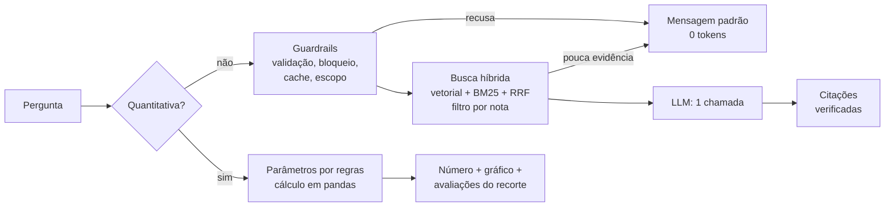
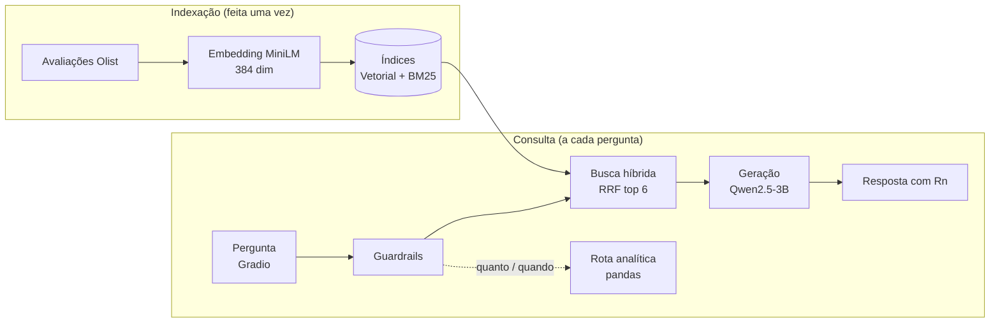

# Voice of Customer Intelligence com RAG

**Tech Challenge Fase 4 — IA para Devs (Pós-Tech).** Sistema que responde, em linguagem natural, perguntas de gestores sobre as ~99 mil avaliações de clientes da Olist. Cada afirmação cita as avaliações que a sustentam. Perguntas sem evidência ou fora do escopo são recusadas. Percentuais e séries temporais são calculados em código, nunca pelo modelo de linguagem.

* **Integrantes:** Jeniffer Meireles, Rodrigo Alves de Souza e Saulo Freitas
* **Vídeo (até 7 min):** 
* **Notebook:** `TECH_CHALLENGE_4_COMPLETO.ipynb`

---

## Em uma frase por parte

| Parte | O que faz | Principal conclusão |
| :--- | :--- | :--- |
| **1. Fundamentos de NLP** | Limpeza, tokenização, stemming, BoW e TF-IDF; classificador de sentimento | O texto prevê a polaridade da nota com F1 ≈ 0,95, então a nota serve como rótulo de sentimento sem custo de LLM |
| **2. Base de conhecimento** | Compara chunking fixo, recursivo e semântico; embeddings e busca híbrida | Todo chunking mistura ou corta avaliações; 1 avaliação = 1 documento |
| **3. RAG** | LLM, citações `[R1]` verificadas, guardrails e casos de borda | No máximo 1 chamada de LLM por pergunta; recusas sem custo |
| **4. Testes e interface** | Bateria de 20 perguntas (6 devem ser recusadas) e interface Gradio | Interface desenvolvida com respostas simuladas, depois ligada ao pipeline real |
| **5. Incrementos analíticos** | Percentuais, rankings, séries mensais, atraso real, temas validados | Números calculados em pandas, com numerador, denominador e recorte |

---

## Como funciona



---

## Decisões técnicas

| Decisão | Por quê |
| :--- | :--- |
| **Sentimento = nota (1–2 negativo, 4–5 positivo)** | A Parte 1 mostra que texto e nota concordam na grande maioria dos casos; classificar ~40 mil textos com LLM custaria tokens sem ganho |
| **1 avaliação = 1 documento, sem chunking** | Avaliações são curtas (mediana ~60 caracteres); chunking separa a nota do texto e impede a citação |
| **Embeddings `paraphrase-multilingual-MiniLM-L12-v2`** | Português, 384 dimensões, rápido na T4 |
| **Busca híbrida (vetorial + BM25 + RRF) com filtro por nota** | Vetores pegam paráfrases; BM25 pega termos exatos; o filtro evita reclamações em perguntas sobre elogios |
| **LLM `Qwen2.5-3B-Instruct` local (alternativa: `gemini-2.5-flash-lite` por API)** | Custo zero por chamada e reprodutível sem chave; a tarefa não exige modelo maior |
| **Guardrails antes do LLM** | Pergunta inválida, injeção, dado pessoal, fora do escopo, sem evidência e cache não geram chamada |
| **Citações conferidas em código** | Referências inválidas são removidas; resposta sem citação válida é rejeitada |
| **Rota analítica separada** | O LLM nunca calcula; percentuais saem do pandas com o denominador explícito |

---

## Como executar

1. Abra `TECH_CHALLENGE_4_COMPLETO.ipynb` no Google Colab com GPU T4.
2. Baixe a base no Kaggle (Olist). Coloque os CSVs na pasta do Drive configurada na Parte 0 ou em `data/`.
   * **Obrigatórios:** `olist_order_reviews_dataset.csv`, `olist_order_items_dataset.csv`, `olist_sellers_dataset.csv`.
   * **Opcionais (ativam análises da Parte 5):** geolocalização, pedidos, clientes e produtos.
3. Vá em **Ambiente de execução > Executar tudo**. A primeira execução baixa os modelos e leva de 15 a 25 minutos.
4. As interfaces abrem com link público ao final das Partes 4 e 5. Os resultados ficam salvos em `resultados/`.

> **Só a interface, sem GPU e com respostas simuladas:**
> ```bash
> pip install gradio pandas && python app/app.py
> ```

---

## Resultados

| Indicador | Valor |
| :--- | :--- |
| F1 do baseline TF-IDF (Parte 1) | 0,953 |
| Discordância texto × nota (Parte 1) | x% |
| Bateria de 20 perguntas (Parte 4) | x/20 |
| Casos de borda (Parte 3) | x/15 |
| Testes analíticos (Parte 5) | x/16 |
| Tokens médios por chamada de LLM | entrada / saída |

---

## Repositório

```text
├── TECH_CHALLENGE_4_COMPLETO.ipynb  # projeto inteiro, Partes 0 a 5
├── app/app.py                       # interface Gradio (modo simulado)
├── docs/ARQUITETURA.md              # estrutura, diagramas e componentes
├── docs/PERGUNTAS_TESTE.md          # bateria de 20 perguntas e critérios
├── docs/INCREMENTOS.md              # análise das bases complementares e incrementos
├── testes/perguntas_teste.json      # bateria em formato de dados
├── data/                            # CSVs da Olist (não versionados)
└── resultados/                      # saídas geradas pelo notebook
```

---

## Limitações

* Os limiares de escopo e relevância (Parte 3) e de temas por embedding (Parte 5) são pontos de partida: a calibração e a validação com amostra rotulada estão no notebook.
* A avaliação é do pedido, não do vendedor; em ~1,3% dos pedidos com mais de um vendedor, ela é atribuída ao de maior valor.
* Diferenças entre estados ou categorias descrevem a base e não explicam causas.

---

## Arquitetura proposta

O sistema é dividido em duas fases: uma **indexação** feita uma única vez e uma **consulta** executada a cada pergunta. As perguntas só leem os índices já construídos, então nenhum embedding é recalculado no momento da consulta.




### 1. Indexação (feita uma vez)
| Etapa | Descrição |
|---|---|
| **Avaliações** | Reviews da Olist. Cada review é um documento e não há chunking, porque os textos são curtos. |
| **Embedding** | Modelo **MiniLM multilíngue**, que gera vetores de **384 dimensões**. |
| **Índices** | Índice **vetorial** (similaridade de cosseno) e índice **BM25** sobre o texto sem acentos. |

### 2. Consulta (a cada pergunta)
| Etapa | Descrição |
|---|---|
| **Pergunta** | O usuário escreve em linguagem natural pela interface **Gradio**. |
| **Guardrails** | Valida a entrada, bloqueia conteúdo indevido, consulta o **cache** e verifica se a pergunta está dentro do **escopo**. |
| **Busca híbrida** | Combina busca vetorial e BM25 com a fusão **RRF (Reciprocal Rank Fusion)** e retorna os **6 reviews mais relevantes**. |
| **Geração** | Só gera resposta se houver **pelo menos 2 evidências**. Nesse caso, faz **1 chamada** ao **Qwen2.5-3B**. |
| **Resposta** | Texto com citações **[Rn]**, cada uma ligada ao `review_id` de origem. |


### 3. Rota analítica (pandas)

Perguntas de **"quanto"** e **"quando"** (contagens, médias, períodos) são calculadas diretamente em **pandas**, sem passar pelo LLM. Isso deixa os números exatos e evita alucinação.

> **Restrição de custo:** cada pergunta faz **no máximo 1 chamada de LLM**.

### Decisões de projeto

- **Sem chunking:** um review já é uma unidade semântica completa.
- **Busca híbrida:** o BM25 encontra termos exatos (produto, marca) e a busca vetorial encontra o mesmo sentido escrito de outra forma. O RRF junta os dois rankings sem precisar calibrar escalas.
- **Mínimo de 2 evidências:** reduz respostas baseadas em um único review isolado.
- **Citações [Rn]:** cada afirmação da resposta pode ser conferida no review original.

### Tecnologias e bibliotecas 

### Ambiente 

| Item | Uso no projeto |
|---|---| 
| Python 3.10+ | Linguagem do projeto | 
| Google Colab (GPU T4) | Execução do notebook, modelo local em fp16 | 
| Google Drive | Armazenamento dos CSVs da Olist | 
| Colab Secrets | Chave de API opcional (`GEMINI_API_KEY`), fora do código |

### Dados e cálculo 

| Biblioteca | Uso no projeto | 
|---|---| 
| `pandas` | Ingestão, limpeza, junção das bases, tabela fato e métricas da rota analítica | 
| `numpy` | Busca vetorial exata (cosseno por produto interno), máscaras de filtro, haversine | 
| `matplotlib` | Séries mensais, rankings por UF e categoria, painéis da Parte 5 | 

### NLP clássico (Parte 1) 

| Biblioteca | Uso no projeto | 
|---|---| 
| `nltk` | Tokenização de palavras e frases, stop words em português, stemmer RSLP | 
| `spaCy` + `pt_core_news_lg` | Lematização, classes gramaticais, dependências e NER | 
| `scikit-learn` | `CountVectorizer`, `TfidfVectorizer`, `LogisticRegression`, validação cruzada e baseline de sentimento | 
| `transformers` (tokenizer BERTimbau) | Demonstração de tokenização por subwords | 

### Recuperação (Partes 2, 3 e 5) 

| Biblioteca / modelo | Uso no projeto | 
|---|---| 
| `sentence-transformers` + `paraphrase-multilingual-MiniLM-L12-v2` | Embeddings de 384 dimensões das avaliações, âncoras de escopo e de temas | 
| `rank-bm25` | Busca lexical (BM25 Okapi) sem acentos e sem palavras genéricas | 
| `faiss-cpu` | Índice vetorial `IndexFlatIP` no experimento de chunking (Parte 2) | 
| Reciprocal Rank Fusion (implementação própria) | Fusão dos rankings vetorial e lexical | 

### Geração e interface (Partes 3 a 5) 

| Biblioteca / modelo | Uso no projeto | 
|---|---| 
| `transformers` + `torch` + `accelerate` | LLM local `Qwen/Qwen2.5-3B-Instruct` em fp16, decodificação gulosa | 
| `openai` (SDK) | Backend alternativo: `gemini-2.5-flash-lite` pelo endpoint compatível com OpenAI | 
| `gradio` | Interface web com modo simulado e modo real, link público no Colab | 

### Dados 

[Brazilian E-Commerce Public Dataset by Olist](https://www.kaggle.com/datasets/olistbr/brazilian-ecommerce/data) (Kaggle): avaliações, itens de pedido e vendedores (obrigatórios); geolocalização, pedidos, clientes e produtos (opcionais, ativam análises da Parte 5). 

